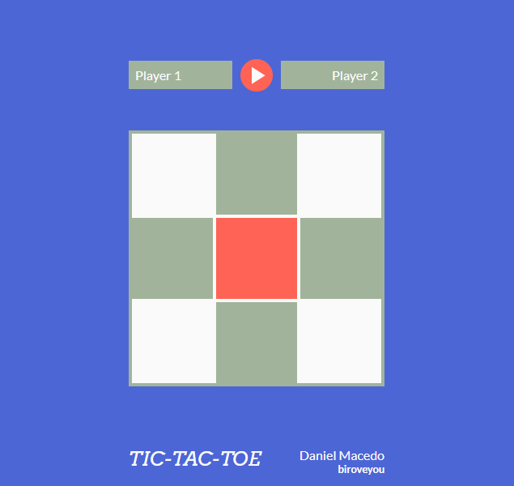

# Tic-Tac-Toe (Jogo da Velha)

🇺🇸 [Read in English](./README.md)

Um jogo da velha para dois jogadores no navegador, feito apenas com HTML, CSS e JavaScript puro. Digite o nome dos dois jogadores, aperte o botão de jogar e acompanhe o placar ao longo das rodadas.

**[Demo online](https://biroveyou.github.io/tic-tac-toe)**



## Funcionalidades

- Dois jogadores com nomes personalizados (ambos obrigatórios e diferentes entre si)
- Indicador de turno mostrando de quem é a vez
- Detecção de vitória e empate (linhas, colunas e diagonais)
- Placar: o tabuleiro é reiniciado a cada rodada, mas a pontuação continua
- Botão de reiniciar que zera o placar e volta para a tela de nomes
- Células desativadas enquanto nenhum jogo está em andamento
- Marcas desenhadas em SVG inline (`X` e `O`), com a célula central destacada

## Como jogar

1. Digite o nome do **Jogador 1** (`X`) e do **Jogador 2** (`O`).
2. Clique no botão laranja de **play**.
3. Alternem as jogadas clicando nas células vazias.
4. Faça três marcas em linha, coluna ou diagonal para vencer a rodada e ganhar um ponto.
5. Clique no botão de **reiniciar** a qualquer momento para zerar o placar e trocar os jogadores.

## Executando localmente

Não é necessário build nem dependências.

```bash
git clone https://github.com/biroveyou/tic-tac-toe.git
cd tic-tac-toe
```

Depois, abra o arquivo `index.html` no navegador.

## Estrutura do projeto

```
.
├── index.html
├── styles.css
├── scripts.js
└── fonts/
    ├── Arvo/   (Regular, Bold, Italic)
    └── Lato/   (Regular, Bold)
```

## Visão geral do código

A lógica em `scripts.js` é organizada com os padrões module e factory, mantendo as responsabilidades separadas:

- **`gameBoard`** (module / IIFE): guarda o estado do tabuleiro 3×3 e expõe métodos para lê-lo, marcar uma célula, listar células vazias e reiniciá-lo.
- **`createPlayer`** (factory): cria um jogador com nome, ordem, símbolo, pontuação e o método `markSpot`.
- **`gameController`** (factory): controla o fluxo do jogo: turnos, verificação de vitória e empate e atualização do placar.
- **`displayController`** (module / IIFE): cuida do DOM: renderiza o tabuleiro, os nomes, o texto de turno e o placar, além dos eventos de clique.

## Tecnologias

- HTML5
- CSS3 (custom properties, Grid e Flexbox)
- JavaScript puro (ES6+)
- Fontes: [Arvo](https://fonts.google.com/specimen/Arvo) e [Lato](https://fonts.google.com/specimen/Lato)

## Autor

**Daniel Macedo** ([@biroveyou](https://github.com/biroveyou))